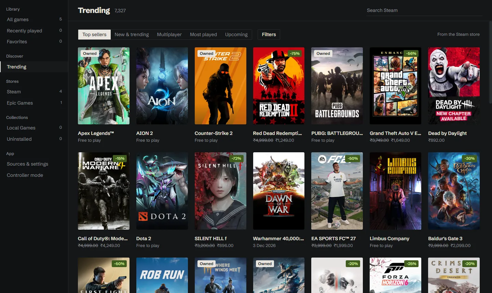
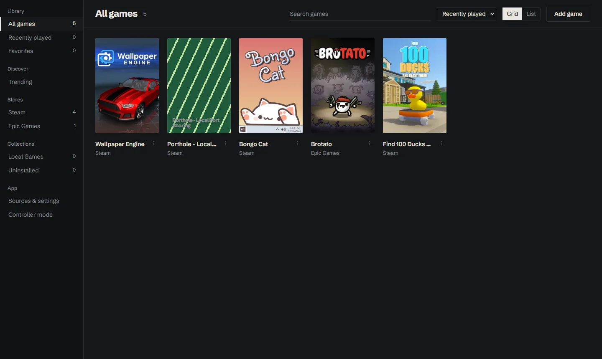
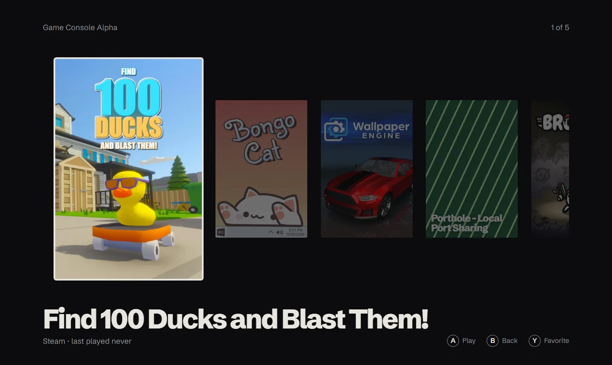
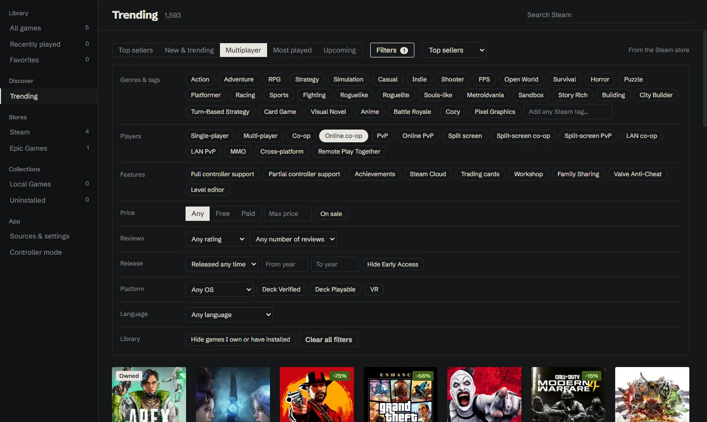
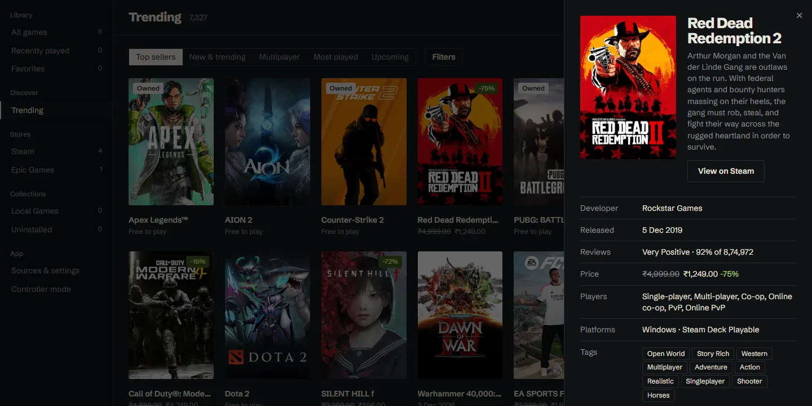

# 🎮 Game Console Alpha

**All your PC games in one place, from every launcher, with one click to play.**

**[⬇️ Download for Windows](https://github.com/giksaw/ConsoleAlpha/releases/latest)** · [See what's coming](#-coming-next) · [Request a feature](#-ask-for-a-feature-or-report-a-problem)

> [!TIP]
> **Developer?** The technical side, including how it works, where data is stored, the project structure and how to build it, is in **[TECHNICAL.md](TECHNICAL.md)**.

---

## ✨ What it does

### 📚 Every game you own, in one library
Game Console Alpha finds the games already installed on your PC. You don't need to sign in to anything. It works with:

**Steam · Epic Games · GOG Galaxy · Battle.net · Ubisoft Connect · EA App · Xbox · Amazon Games · itch.io · Rockstar Games**

Got a game from somewhere else? Add it yourself in a couple of clicks, or tell the app which folder you keep games in and it will offer new ones as they appear.

### ⬇️ Install games you already bought
The Steam and Epic Games pages also show the games you own but haven't installed. Click **Install**, and that store's installer opens. You can watch the download's progress and speed right on the game's card.

### 🔥 Discover what's popular
The **Trending** page shows what's hot on Steam right now, with prices in your own currency:

- **Top sellers**, **New & trending**, **Multiplayer**, **Most played** and **Upcoming**
- **Search** the whole Steam store. Results keep loading as you scroll.
- **Filters** to find exactly what you're after:
  - genre, and hide genres you don't like
  - co-op, online, split screen, LAN
  - price, sales, reviews, release date
  - Steam Deck, VR, language
- Games you already have are marked **Owned** or **Installed**, so you can play or install them straight from there.
- Each game's details show whether community download sites list it.

### 🕹️ Play from the couch
Press **Start** on your controller and the app switches to a big-screen **controller mode**. Browse with the stick and press **A** to play.

### 🎨 Make it yours
- Pick your own **cover art**, or let the app find it for you
- Mark **favorites**, and hide games you don't want to see (you can always bring them back)
- Sort games into **Backlog / Playing / Finished**
- **Grid or list** view, search, and a **Recently played** list
- Right-click any game to play it, install it, open its store page or folder, change its cover, favorite it or hide it

### 🔒 Private by design
No account and no ads, and nothing about you is collected. Your library stays on your PC. Read the [privacy policy](https://giksaw.github.io/ConsoleAlpha/privacy-policy.html).

---

## 📸 Screenshots

<table>
  <tr>
    <td> <b>Your library</b>: every launcher in one place</td>
    <td> <b>Controller mode</b>: made for the couch</td>
  </tr>
  <tr>
    <td> <b>Filters</b>: find your next game</td>
    <td> <b>Game details</b>: price, reviews, players, tags</td>
  </tr>
</table>

---

## 🚀 Get it in a minute

1. **Download** `GameConsoleAlpha-<version>-x64-setup.exe` from the [latest release](https://github.com/giksaw/ConsoleAlpha/releases/latest).
2. **Run it.** It installs just for you, so you don't need administrator rights.
3. If Windows says *"Windows protected your PC"*, click **More info → Run anyway**. This happens because the app is new and not yet "signed", which is a paid certificate.

Already have an older version? Just run the new installer. Your games and settings are kept.

**Requirements:** 64-bit Windows 10 (version 2004 or later) or Windows 11.

---

## ❓ Questions

<b>Is it free?</b>

Yes, completely. There's nothing to buy and no ads. It's open source under the MIT license.

<b>Does it download or sell games?</b>

No. When you click **Install**, the app asks Steam or Epic Games to install the game, and the download runs in that launcher as usual. Games start the same way they normally would, through Steam, Epic and so on, so your saves, achievements and friends lists all keep working.

<b>Do I need to log in or give it my passwords?</b>

No. It reads what your launchers have already saved on your PC. It never asks for an account.

<b>How do I update it?</b>

For now, download the newest installer from [Releases](https://github.com/giksaw/ConsoleAlpha/releases) and run it. Automatic updates are [on the way](#-coming-next).

<b>Is there a Microsoft Store version?</b>

It's coming soon, and it will update itself. Install either the Store version or this one, not both, because they share the same library and settings.

---

## 🛣️ Coming next

| | Feature | What it means for you |
|---|---|---|
| 🖥️ | **Can it run on my PC?** | Before you buy or install a game, see whether your PC meets its minimum and recommended requirements: processor, graphics card, memory and disk space, checked against your own hardware. |
| 🔄 | **Automatic updates** | The app tells you when a new version is out and updates itself, so you never have to check for a new download. |
| 🏪 | **Microsoft Store** | Install it straight from the Microsoft Store. |

Want something that isn't on this list? 👇

---

## 💬 Ask for a feature or report a problem

Your ideas shape what gets built next. All you need is a free GitHub account:

- 💡 **Have an idea?** [Request a feature](https://github.com/giksaw/ConsoleAlpha/issues/new?template=feature_request.yml). Describe what you'd like and why. You don't need to know anything technical.
- 🐞 **Something not working?** [Report a problem](https://github.com/giksaw/ConsoleAlpha/issues/new). Say what you did, what happened, and which version you're on.
- 👍 **Like someone else's idea?** Browse the [open requests](https://github.com/giksaw/ConsoleAlpha/issues) and give it a thumbs-up. Popular requests get looked at first.

---

## 🛠️ For developers

Curious how it works, or want to build it yourself? **[TECHNICAL.md](TECHNICAL.md)** covers:

- the tech stack (Rust + Tauri 2, plain JavaScript)
- how each launcher's games are detected and started
- where the Trending data comes from
- where your data is stored
- the project structure
- building the installer and the Microsoft Store package

---

MIT licensed · <a href="https://giksaw.github.io/ConsoleAlpha/privacy-policy.html">Privacy policy</a> · Made by Giksaw Interactive

